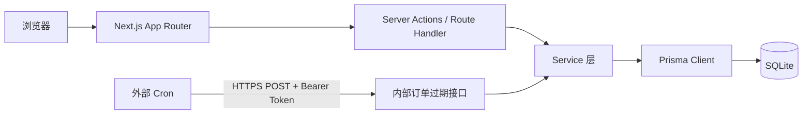
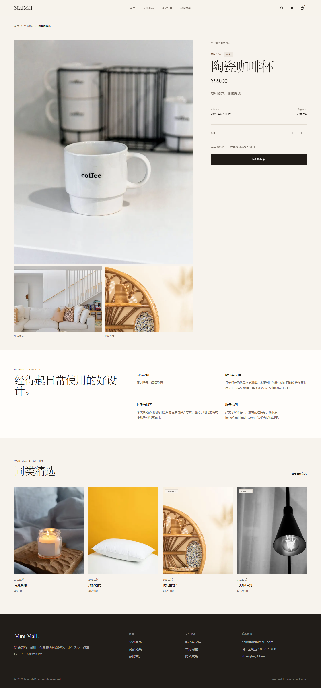

# Mini Mal1

基于 Next.js 的全栈微型电商项目。项目覆盖用户注册登录、商品浏览、购物车、
收货地址、订单创建、模拟支付、订单取消、库存恢复和超时订单自动处理，
重点验证支付与订单在 SQLite 单实例环境中的一致性和幂等性。

> 求职展示站按作品名 **Mini Mal1** 呈现。现有应用界面品牌仍为 **Mini Mall**，
> 本阶段未修改业务 UI、品牌资源、数据库结构或支付订单逻辑。

静态展示站位于 [`showcase/`](showcase/)，独立使用 HTML、CSS 和 JavaScript；
完整业务系统继续在当前 Next.js 仓库中运行。

GitHub 仓库：<https://github.com/zhenwuchen/Mini-Mal>

## 项目定位与开发目标

这个项目不是通用的电商脚手架，也不是接入真实资金渠道的生产商城。它以可以
完整运行的微型业务为边界，集中演示以下工程问题：

- 用户数据隔离与受保护操作；
- 下单时服务端定价、库存扣减和购物车清理的事务性；
- 模拟支付状态迁移、支付幂等和并发完成保护；
- 取消订单时订单状态、待处理支付与库存恢复的一致性；
- 支付截止时间与超时订单扫描；
- 内部任务接口的最小权限鉴权；
- Node.js 单实例与 SQLite 持久化部署。

## 技术栈

| 层次 | 技术 |
| --- | --- |
| Web 应用 | Next.js 16 App Router、React 19、Server Actions |
| 语言与样式 | TypeScript、Tailwind CSS 4 |
| 认证 | Auth.js / NextAuth Credentials、bcryptjs |
| 数据访问 | Prisma Client 5 |
| 数据存储 | SQLite |
| 运行环境 | Node.js 22.19.x |

## 核心业务功能

- **用户注册与登录**：注册输入校验、密码哈希、Credentials 登录、会话读取。
- **商品分类、列表与详情**：从 Prisma + SQLite 读取分类与商品数据。
- **购物车管理**：添加、修改数量、移除商品，使用当前库存与商品状态校验。
- **收货地址与订单创建**：保存地址快照、服务端定价、扣减库存、清理购物车。
- **模拟支付成功和失败**：支持待支付、成功、失败和取消等状态迁移。
- **订单取消与库存恢复**：取消待支付订单，取消待处理支付并恢复订单明细库存。
- **超时订单自动取消**：外部 Cron 调用内部接口，扫描并取消到期订单。
- **内部任务接口鉴权**：独立 Bearer Token 配置与常量时间摘要比较。

## 项目架构



页面与 Route Handler 不直接承担支付、取消或库存写入。关键一致性逻辑集中在
`src/lib/*-service.ts`，通过 Prisma Transaction 和条件更新保护业务不变量。

完整说明见 [`docs/showcase/technical-architecture.md`](docs/showcase/technical-architecture.md)。

## 重点技术实现

### 支付状态机与幂等

`src/lib/payment-status.ts` 显式定义支付状态迁移。
`src/lib/payment-service.ts` 使用 provider + idempotencyKey 唯一约束复用重复请求，
并通过带状态条件的更新、事务和有限重试避免同一订单产生多个成功支付。

### 支付截止时间

订单创建时写入 30 分钟支付窗口。完成支付时，最终订单更新在数据库中读取当前
时间并校验 `expiresAt`，避免应用进程时间与数据库写入边界不一致。

### 订单取消与库存恢复

`src/lib/order-cancel-service.ts` 在事务中更新订单状态、取消待处理支付，
按订单明细恢复商品库存；任一步失败则整体回滚。重复取消不会再次恢复库存。

### 超时订单扫描

`src/lib/order-expiration-service.ts` 支持批次大小、时间预算和持久化游标。
扫描按到期时间与订单 ID 稳定排序，并在批次之后继续轮转，避免持续失败订单
长期占住扫描起点。

### 内部任务鉴权

`src/lib/internal-task-auth.ts` 使用独立 `CRON_SECRET`，验证 Base64URL 格式、
最小解码长度和 Bearer Token，并通过 SHA-256 摘要与 `timingSafeEqual` 比较。
该密钥不会回退到 `AUTH_SECRET`，也不会暴露在响应中。

## 项目运行截图

以下截图来自本地运行后的真实页面，测试数据仅用于界面验收。完整截图清单见
[`screenshots/README.md`](screenshots/README.md)。


| 商品列表 | 商品详情 |
| --- | --- |
|  |  |

## 本地运行方式

要求 Node.js `>=22.19.0 <23`。

```powershell
npm ci
Copy-Item .env.example .env
npm run db:generate
npm run db:migrate:deploy
npm run dev
```

`.env` 至少需要合法的 `DATABASE_URL` 和独立的 `AUTH_SECRET`。内部订单过期接口
还需要独立的 Base64URL `CRON_SECRET`。不要把真实密钥提交到仓库。

`npm run db:migrate:deploy` 只应用仓库中现有的 Migration，不创建新 Migration。
只有在确实需要演示商品与初始管理员数据时，才对全新空数据库执行：

```powershell
npm run db:seed
```

注意事项：

- 不在本阶段执行 `db:push`、`db:seed` 或数据库写入到 `prisma/dev.db`。
- `db:seed` 会更新种子商品库存，已有业务数据的环境不要重复执行。
- 不使用 `prisma/dev.db` 作为生产数据库，也不把 SQLite 文件部署到 Vercel。

静态展示站可独立预览：

```powershell
node showcase/serve.mjs
```

## 测试与质量验证

```powershell
npm test
npm run lint
npx tsc --noEmit
npm run build
node --test showcase/check.mjs
```

测试通过临时目录和独立 SQLite 文件加载仓库中的 Migration，断言测试数据库
路径不包含 `dev.db`。支付、订单创建、订单取消和订单过期测试覆盖了并发、
回滚、幂等与截止时间边界。

展示站检查器验证入口文件、内部链接、本地图片、图片替代文本、虚构远程地址、
敏感配置占位和虚构架构组件。

## 部署架构说明

项目采用两套明确分离的部署边界：

| 目标 | 内容 | 运行方式 |
| --- | --- | --- |
| Vercel 静态展示 | `showcase/` 展示页与截图 | Root Directory 设为 `showcase`，无构建、无环境变量、无 Functions |
| 完整业务演示 | Next.js + Prisma + SQLite | Node.js 22.19 单实例，持久化数据库文件 |

完整系统当前不使用 Vercel Serverless，也不使用 PostgreSQL、Redis、消息队列、
多实例集群或后台 Worker。生产部署、Migration、备份和恢复步骤见
[`docs/production-deployment.md`](docs/production-deployment.md)。

## 项目限制和后续规划

- 支付为模拟流程，没有接入真实支付渠道。
- 没有真实物流、售后、库存中心或运营后台完成链路。
- 当前完整业务系统采用 SQLite 单实例写入模型，不支持多应用实例并发写入。
- 生产方案需要外部 Cron 每分钟调用内部订单过期接口。
- Vercel 只承载静态展示站，不承载完整电商 API 或数据库。
- 展示视频仍待人工录制；没有截图或视频的场景使用明确占位。

## 求职展示文档

- [技术架构](docs/showcase/technical-architecture.md)
- [核心业务流程](docs/showcase/core-business-flows.md)
- [支付与订单一致性设计](docs/showcase/payment-order-consistency.md)
- [超时订单处理机制](docs/showcase/expired-order-processing.md)
- [SQLite 单实例生产方案摘要](docs/showcase/sqlite-production-deployment.md)
- [演示视频脚本与素材清单](docs/showcase/demo-guide.md)
- [GitHub 公开准备检查](docs/showcase/github-release-checklist.md)
