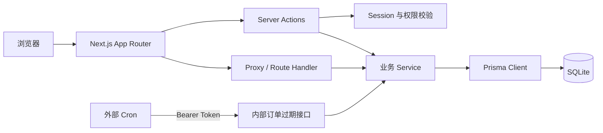

# Mini Mal1

Mini Mal1 是一个基于 Next.js 16、React 19、Prisma 和 SQLite 的全栈微型电商项目。
项目覆盖用户注册登录、商品浏览、购物车、收货地址、订单创建、模拟支付、
订单取消、库存恢复、超时订单处理，以及商品、分类和订单后台管理。

项目重点不是模拟真实支付通道，而是验证订单、支付和库存在 SQLite 单实例环境中的
事务一致性、幂等性、并发保护和权限边界。支付流程使用明确标注的模拟支付，
不接入真实资金渠道。

GitHub 仓库：<https://github.com/zhenwuchen/Mini-Mal>

## 项目截图


更多当前页面截图位于 [`showcase/assets/screenshots/`](showcase/assets/screenshots/)，
包括商品详情、购物车、结算、订单详情、个人资料、后台商品与订单管理，
以及 390px 移动端商品列表。

独立的静态求职展示站位于 [`showcase/`](showcase/)，不连接业务数据库或内部任务接口。

## 核心功能

### 用户与账户

- 邮箱密码注册、登录、退出和 JWT Session。
- bcrypt 密码哈希，客户端 Role 字段不会影响注册权限。
- 购物车、地址和订单按当前 Session 用户隔离。
- 个人账户页与展示名称编辑。
- 邮箱、密码哈希和角色不开放给用户自助修改。

### 商品与购物袋

- 数据库驱动的商品分类、列表和商品详情。
- 商品名称搜索、分类筛选、价格/最新排序。
- 服务端数据库分页，每页固定 12 件，保留搜索、分类和排序参数。
- 商品卡片快捷加购，统一复用购物车 Service。
- 商品详情数量选择、购物车数量修改和移除。
- 加购和结算时实时校验商品状态、库存和当前数据库价格。
- 后台支持商品新增、编辑、上下架和归档。
- 后台支持分类新增、编辑和安全删除。

### 地址、订单与支付

- 收货地址新增、编辑、删除和默认地址切换。
- 订单创建时保存商品和结构化地址快照。
- 同一用户和结算键重复提交返回原订单，避免重复扣库存。
- 模拟支付的开始、成功、失败和重试。
- 支付状态机、支付幂等键、金额与币种校验。
- 支付截止时间使用数据库时间执行最终边界判断。
- 取消待付款订单时原子取消支付并恢复库存。
- 重复或并发取消不会重复恢复库存。
- 超时订单扫描支持批次、时间预算和持久化轮转游标。
- 内部过期任务使用独立 Bearer Token 鉴权，不复用用户 Session。

### 运营后台

- `/admin` 首页展示数据库中的商品、分类和订单统计。
- 商品列表支持搜索、分类、状态筛选和分页。
- 商品新增、编辑、上下架和历史安全归档。
- 分类列表展示关联商品数，有关联商品时禁止删除。
- 订单列表支持订单编号、订单状态、支付状态筛选和分页。
- 订单详情展示商品快照、支付记录、用户和地址快照。
- 管理员只能通过现有订单取消 Service 处理待付款订单。
- 后台页面和每个后台 Server Action 都在服务端验证管理员身份。

## 技术栈

| 层次 | 技术 |
| --- | --- |
| Web | Next.js 16 App Router、React 19、Server Actions |
| 语言与样式 | TypeScript、Tailwind CSS 4 |
| 认证 | Auth.js / NextAuth Credentials、bcryptjs |
| 数据访问 | Prisma Client 5 |
| 数据库 | SQLite |
| 测试 | Node.js Test Runner、tsx |
| 运行环境 | Node.js 22.19.x |

## 架构



页面负责渲染和交互，Server Actions 与 Route Handler 负责请求边界、输入解析和
错误映射。商品、购物车、地址、订单、支付、取消、后台和超时逻辑集中在
`src/lib/` 的 Service 与领域校验模块中。

## 有技术含量的实现

### 1. 支付状态机

`src/lib/payment-status.ts` 显式定义支付状态迁移。非法的
`SUCCEEDED -> PENDING`、`CANCELLED -> SUCCEEDED` 等操作会被拒绝。

### 2. 支付幂等与并发保护

`src/lib/payment-service.ts` 使用 provider + idempotencyKey 唯一约束复用重复请求，
并通过事务、状态条件更新和有限重试保证同一订单最多只有一个成功支付。

### 3. 数据库时间控制支付截止

完成支付时，最终订单更新使用 SQLite 当前时间判断 `expiresAt`，避免应用进程
时间偏差或写锁等待跨越截止时间后仍将订单更新为已付款。

### 4. 订单取消与库存恢复的原子性

`src/lib/order-cancel-service.ts` 在同一事务中更新订单、取消待处理支付并恢复库存。
任一步失败都会整体回滚；重复取消不会再次增加库存。

### 5. 超时任务公平轮转

`src/lib/order-expiration-service.ts` 使用批次大小、时间预算和持久化游标扫描
到期订单，避免持续失败订单永久占住扫描起点。

### 6. Server Actions 服务端权限

用户写操作均通过当前 Session 获取身份，不接受客户端指定的用户 ID。
后台每个 Server Action 都再次调用 `requireAdmin`，页面隐藏不作为权限边界。

## 本地运行

要求 Node.js `>=22.19.0 <23`。

```powershell
npm ci
Copy-Item .env.example .env
```

编辑 `.env`：

- `DATABASE_URL` 默认使用 `prisma/dev.db`。
- 将 `AUTH_SECRET` 替换为独立的高熵 Secret。
- 需要测试内部过期任务时，再配置独立的 Base64URL `CRON_SECRET`。

初始化数据库：

```powershell
npm run db:generate
npm run db:init
```

`db:init` 是兼容 Windows 的本地初始化入口，只应用 `prisma/migrations/` 中已有的
Migration，并维护 `_prisma_migrations` 历史；重复执行是安全的。Linux 生产部署
继续使用 `npm run db:migrate:deploy`。

### 管理员和演示数据 Seed

Seed 是可选的，并且只用于全新空数据库。执行前在本地 `.env` 中取消注释并替换：

```dotenv
ADMIN_EMAIL="admin@example.com"
ADMIN_PASSWORD="replace-with-at-least-12-characters"
ADMIN_NAME="Mini Mal1 Admin"
```

管理员密码不能使用示例值。`prisma/seed.ts` 要求密码至少 12 位，并会拒绝
`replace-with-at-least-12-characters` 这个示例密码。

```powershell
npm run db:seed
```

Seed 只处理显式配置的 `ADMIN_EMAIL`，不会扫描或批量提升普通用户。邮箱不存在时
会创建管理员；邮箱已属于管理员时会更新显示名称；邮箱已属于普通用户时会直接
失败，绝不修改其角色。Seed 会重置种子商品库存，因此不应在已有业务数据的
环境中重复执行。

启动开发环境：

```powershell
npm run dev
```

静态展示站可单独预览：

```powershell
node showcase/serve.mjs
```

## 商品图片规则

当前项目只支持站内图片资源：

- 路径必须以 `/images/` 开头。
- 支持 JPG、JPEG、PNG、WebP、AVIF 和 GIF。
- 禁止远程 URL、协议相对地址、反斜杠、查询参数和路径穿越。
- 后台保存时执行服务端校验；数据库中的旧远程地址在渲染时会回退到本地占位图。

因此 `next/image` 不需要配置任意远程域名白名单。

## 测试

```powershell
npm test
npm run lint
npx tsc --noEmit --incremental false
npm run build
node --test showcase/check.mjs
```

`npm test` 会通过 `scripts/run-tests.mjs`：

1. 在操作系统临时目录创建新的 SQLite 数据库。
2. 仅将仓库 Migration 应用到临时数据库。
3. 在启动任何测试进程前设置统一 `DATABASE_URL`。
4. 让所有直接创建 `PrismaClient` 的测试连接同一个临时数据库。
5. 在结束时清理临时目录。
6. 对比测试前后 `prisma/dev.db` 的 SHA-256；只要开发数据库发生变化就判定失败。

不需要手动设置测试 `DATABASE_URL`，正常执行 `npm test` 不会写入开发数据库。

## 项目限制

- 支付为模拟流程，没有接入真实支付渠道。
- 没有真实物流、退款审批、优惠券或第三方库存中心。
- 后台只提供 MVP 范围商品/分类管理和订单查询、取消。
- 完整业务系统按 SQLite 单实例设计，不支持多应用实例并发写。
- Session 中的角色基于 JWT，管理员权限调整通常需要等待 Session 更新或重新登录。
- 登录目前没有生产级速率限制。
- 当前没有公开生产部署；静态展示站可以独立部署。
- 演示视频尚未录制，展示站使用明确占位，不伪造视频内容。

## 文档

- [技术架构](docs/showcase/technical-architecture.md)
- [核心业务流程](docs/showcase/core-business-flows.md)
- [支付与订单一致性](docs/showcase/payment-order-consistency.md)
- [超时订单处理](docs/showcase/expired-order-processing.md)
- [截图清单](screenshots/README.md)
- [静态展示站](showcase/README.md)
- [生产环境参考](docs/production-deployment.md)
